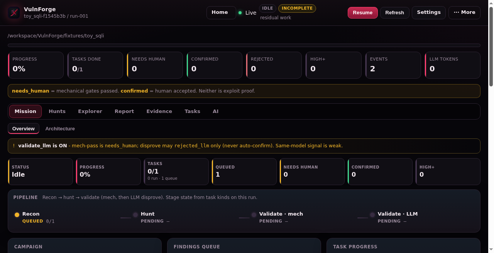
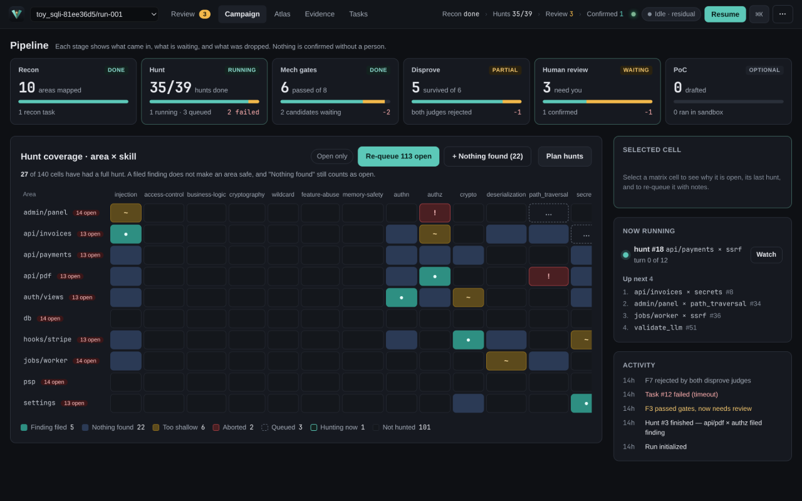
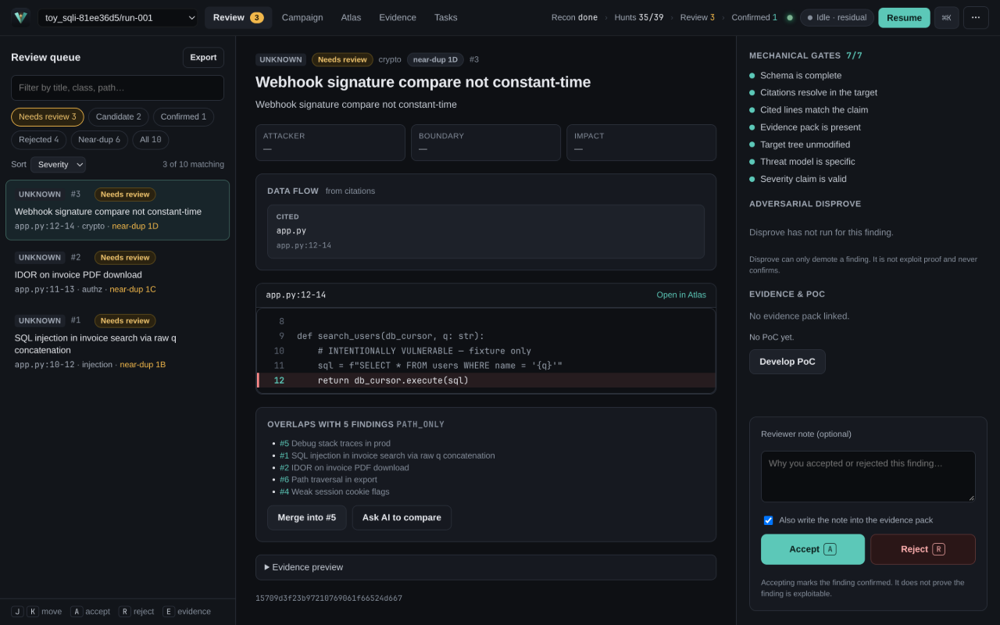
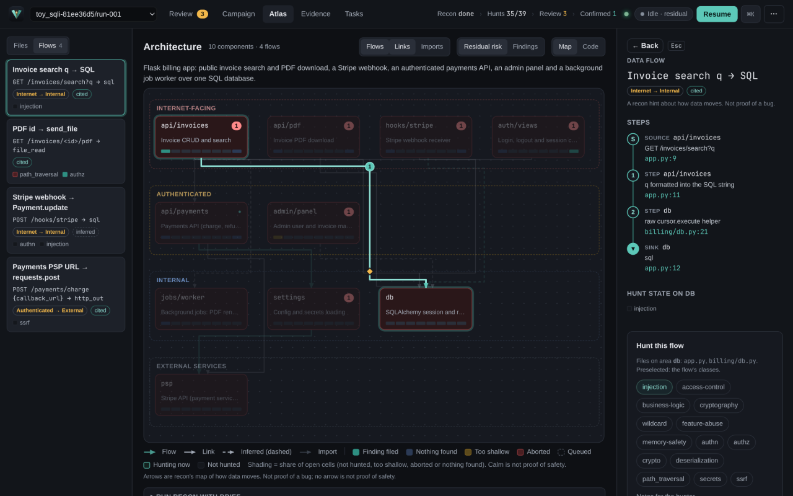

# VulnForge

Local, model-agnostic vulnerability discovery harness for [LM Studio](https://lmstudio.ai/) (or any OpenAI-compatible endpoint) and coding agents.

**One loop:** recon → hunt → mechanical validation → LLM disprove (on by default) → human review — steered from a research-cockpit dashboard. LLM tool-use stages run on the [Strands Agents](https://strandsagents.com/) runtime.

| Label | Meaning |
|-------|---------|
| **`needs_human`** | Passed **mechanical** gates (shape, citations, evidence / justified `no_poc`). **Not** exploit proof. |
| **`confirmed`** | A **human** accepted the finding on the Review tab. Still **not** exploit proof. |

Automation never auto-confirms. Prefer honest `submit_none` over inventing findings.

While `validation_mech.pending_llm` is true (LLM disprove still running), **Accept is hard-blocked** on the server and in both the Review tab and the HITL inbox — Reject stays available, and there is no force override (shipped in #160, closes #154).



---

## Quickstart

Two commands from the repo root (the folder with `pyproject.toml`):

| | Linux / macOS | Windows |
|---|---|---|
| **Install** (once, and again after `git pull`) | `./install.sh` | `install.cmd` |
| **Start** the dashboard | `./start.sh` | `start.cmd` |

Then open **http://127.0.0.1:8787**. From there you can create an audit (**New**), point it at a model (**Settings**) and **Start** Ralph, all without touching the CLI.

The installer creates `.venv` in this folder, installs the `vf` command into it, and checks that it runs. It is safe to re-run and repairs a broken `.venv`. `./start.sh` installs first if you skipped that step, and passes extra arguments on (`./start.sh --port 8788`).

### What you need

- **Python 3.11 or newer.** The installer checks. If your Python is older, or cannot create virtual environments (stock Debian / Ubuntu ship without `python3-venv`), it tells you the one command that fixes it, or offers to download [uv](https://docs.astral.sh/uv), which brings its own Python and leaves the system one alone.
- An **OpenAI-compatible chat API** (typical: LM Studio on `http://127.0.0.1:1234/v1`). The dashboard works without a loaded model; recon/hunt tasks need one.
- A few GB free disk for runs, transcripts, and evidence packs.

**Scope:** source-code analysis only (`code_static`). PE binaries and reverse-engineering tooling are not supported. Sandbox PoC is **off** unless you opt in (Docker + gVisor `runsc` or a microVM on Linux) — see [docs/harness/validate/SANDBOX_HOST.md](docs/harness/validate/SANDBOX_HOST.md).

### Point it at your model

Dashboard **Settings**: add a host → Refresh catalog → Verify → assign roles → Save (`config/ui_settings.json` overrides YAML). Or edit `config/default.yaml` (`llm.base_url`, exact `llm.model` from `GET /v1/models`, `llm.api_mode` — usually `chat_completions` for LM Studio). Env overrides: `VF_BASE_URL`, `VF_MODEL`, `VF_HOST`+`VF_PORT`.

### Use the CLI

Activate the environment once per terminal, then `vf` is on your PATH:

```bash
source .venv/bin/activate        # Windows PowerShell: .venv\Scripts\Activate.ps1
vf --help
```

Smoke the toy fixture:

```bash
vf init --target fixtures/toy_sqli
# → runs/<target_id>/run-001

vf dashboard
# → http://127.0.0.1:8787   (same as ./start.sh)
```

Leave the dashboard running. Open the new run and **Start** Ralph, or in another terminal:

```bash
python scripts/ralph.py --run-dir runs/<target_id>/run-001 --max-tasks 20
```

After `git pull`, run the installer again (new dependencies) and restart the dashboard (new UI).

<details>
<summary>Manual install (what the installer does)</summary>

```bash
python3 -m venv .venv            # needs Python 3.11+ with the venv module
source .venv/bin/activate
pip install -e ".[dev]"          # ".[dev]" adds pytest; plain "." is enough to run
vf --help
```

With [uv](https://docs.astral.sh/uv): `uv venv --seed --python 3.12 .venv && uv pip install --python .venv/bin/python -e ".[dev]"`.

</details>

---

## How a run looks

A **run** is one durable audit against a target tree. Ralph drains the queue: recon → hunts → validate. Each run page has five tabs under one header: **Review**, **Campaign** (the default), **Atlas**, **Evidence** and **Tasks**. The header strip carries the run totals (recon, hunts, review, confirmed).

**Campaign** shows the pipeline stage by stage and the hunt-coverage matrix (area × skill), with what is running and what is next:



**Review** is the human gate: a queue, the finding with its cited code, and a verdict rail with the mechanical gates, disprove judges, PoC and Accept / Reject:



What the pipeline is telling you:

- **Needs Human** — mechanical gates passed; open **Report** (or the HITL inbox) to accept or reject. Neither state is exploit proof. Accept stays disabled while `pending_llm` is true.
- **Confirmed / Rejected** — only change when a human acts in Report / HITL. The LLM may **disprove** (reject path); it never auto-confirms. Accept cannot fire until dual disprove settles.
- **Pipeline** — stage state from task kinds on this run (`Recon → hunt → validate (mech, then LLM disprove)`).

Steer from **Atlas** (hunt an area or a traced flow, or select code and enqueue a hunt), **Campaign** (re-queue open cells, plan hunts) and **Review** (accept / reject / develop PoC). Coverage cells that are not hunted, too shallow, aborted or "nothing found" are all **open**: a miss is not proof of safety.

---

## Architecture map

**Atlas** is the recon map for the run: components in trust-zone bands (Internet-facing, Authenticated, Internal, External, Build) with arrows for how data moves. Flows are traced by recon from an entry point to a sink, and every step cites `path:line`; uncited links are drawn dashed. Pick a flow to highlight its path and hunt it.



Before any model runs, Atlas shows a **mechanical skeleton** built from the codemap, import edges and the sink pre-index. Recon then labels it (zones, cited relations) and the flow tracer adds flows. Arrows steer hunts; they are not proof of a bug, and no arrow is not proof of safety. Spec: [`docs/harness/recon/FLOWS.md`](docs/harness/recon/FLOWS.md).

---

## Daily workflow

| Step | Command / UI |
|------|----------------|
| New audit | Dashboard **New**, or `vf init --target PATH` |
| Drive queue | Dashboard **Start** / **Resume**, or `python scripts/ralph.py --run-dir DIR` |
| One task | `vf run-once --run-dir DIR` |
| Status | `vf status --run-dir DIR`, run header strip |
| Campaign verbs | `start` `stop` `pause` `resume` `status` `findings` `gate` — [docs/harness/CAMPAIGN.md](docs/harness/CAMPAIGN.md) |
| Steer | Atlas, Campaign, Review |
| Dev tools | Home → **Dev** (hunt skills, recon agents) |
| Tool gaps | `vf tool-gaps --run-dir DIR` or Home **Tool gaps** |

### Useful CLI

| Command | Use |
|---------|-----|
| `vf init --target PATH` | New run under `runs/` |
| `vf run-once --run-dir DIR` | Lease + execute one task |
| `vf status --run-dir DIR` | Task/finding summary |
| `vf project --run-dir DIR` | Regenerate `project/*` |
| `vf tool-gaps --run-dir DIR` | Mine transcripts for tool gaps |
| `vf dashboard` | Research cockpit (`--host` / `--port` optional) |
| `vf export-validation-job --finding-id N` | Zip finding + evidence for handoff |
| `vf validate-poc --finding-id N [--execute]` | Enqueue or run PoC harness (opt-in sandbox) |
| `vf delete-run --run-dir DIR` | Permanently delete a run |
| `python scripts/ralph.py --run-dir DIR` | Outer loop until idle / STOP / budget |

Default dashboard: **http://127.0.0.1:8787**

```bash
vf dashboard --host 127.0.0.1 --port 8787
```

### Dashboard surfaces

| Surface | Purpose |
|---------|---------|
| **Home** | All runs, progress, LLM token rollups |
| **Review** | Findings review (accept / reject / develop PoC); Accept hard-blocked while `pending_llm` |
| **Campaign** | Pipeline, hunt-coverage matrix, plan hunts, re-queue open cells (default tab) |
| **Atlas** | Trust-zone map with data-flow arrows; recon re-run, History; browse code and enqueue hunts |
| **Evidence** | On-disk evidence packs |
| **Tasks** | Queue, transcripts, event timeline |
| **AI** | Run-bound co-pilot (mutating tools need Confirm) |
| **Dev** | Hunt skills, recon agents, generate custom skills |
| **Benchmarks** | Mechanical L0 suites (no live model required on Run); live LLM optional |

---

## Project layout

```text
.
├── vulnforge/           # Python package (control plane, stages, UI)
├── seeds/               # Package seed library
├── config/              # default.yaml, hunt_profiles/, recon_agents/
├── install.sh, start.sh # Install / start the dashboard (Windows: install.cmd, start.cmd)
├── scripts/ralph.py     # Outer loop
├── docs/                # LAYOUT.md, harness docs, images/
├── fixtures/            # Toy targets for tests / first run
├── skill/SKILL.md       # Optional agent skill for coding agents
├── tests/
└── pyproject.toml
```

If you only cloned the package folder, place `seeds/`, `config/`, `scripts/`, `fixtures/`, and `pyproject.toml` next to `vulnforge/` so `PROJECT_ROOT` resolves. See [`docs/LAYOUT.md`](docs/LAYOUT.md) and [`seeds/README.md`](seeds/README.md).

---

## Troubleshooting

| Problem | Fix |
|---------|-----|
| `ensurepip is not available`, `No module named pip`, or `pip: command not found` | The system Python has no `venv` module, and a half-built `.venv` was left behind. Run `./install.sh`; it rebuilds `.venv` and offers a fix. |
| `requires a different Python: 3.x not in '>=3.11'` | Python is too old. Run `./install.sh`; it finds a newer one or offers to fetch one. |
| `externally-managed-environment` | `pip` ran against the system Python instead of `.venv`. Use `./install.sh`, not a bare `pip install`. |
| `vf: command not found` | `source .venv/bin/activate` (once per terminal), or use `./start.sh`. If `.venv` is missing, run `./install.sh`. |
| Anything else odd after an upgrade | `./install.sh --recreate` (Windows: `install.cmd -Recreate`) rebuilds `.venv` from scratch. |
| Dashboard import errors | Re-run `./install.sh` from the repo root (FastAPI is a core dependency). |
| Recon/hunt fail with transport | Start LM Studio; check `config/default.yaml` `base_url` / `model` |
| Empty / truncated answers | Raise `llm.max_tokens` (reasoning models need headroom) |
| Wrong prompts path | Run from repo root; ensure `seeds/system/` exists beside `vulnforge/` |
| Port in use | `vf dashboard --port 8788` |

Model-specific notes (Ornith toolgen vs tool_calls, mlx token caps): see `toolgen.md` and Dashboard **Settings → Optimize AI settings**.

---

## Docs

- [`docs/README.md`](docs/README.md) — which file to open
- [`PROTOCOL.md`](PROTOCOL.md) — authority model, labels, apply-candidate contract
- [`AGENTS.md`](AGENTS.md) — extending tools, profiles, and the cockpit
- [`docs/LAYOUT.md`](docs/LAYOUT.md) — where is X? (seeds, tools, config)
- [`skill/SKILL.md`](skill/SKILL.md) — optional skill for coding agents using this harness

## License

MIT

---

## Authorized use

VulnForge is for **authorized** defensive review of codebases you own or have permission to audit. Do not point it at systems or trees outside that scope.

